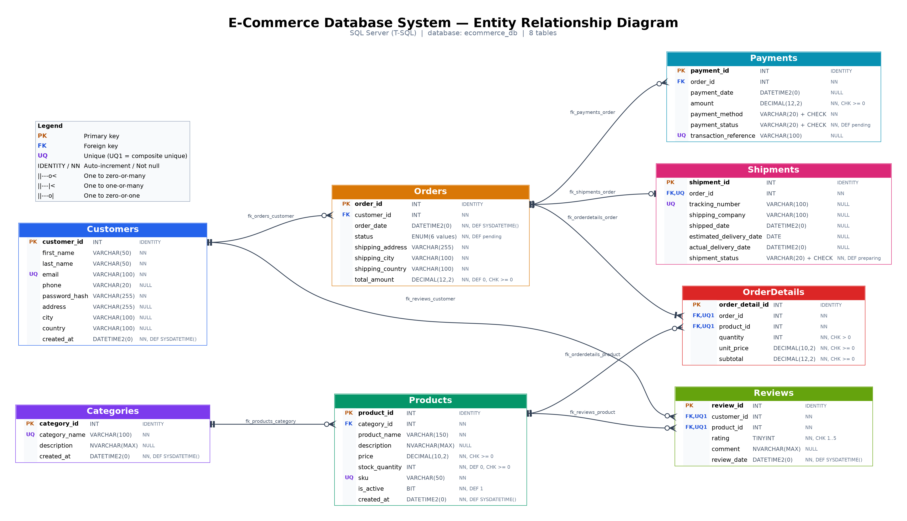
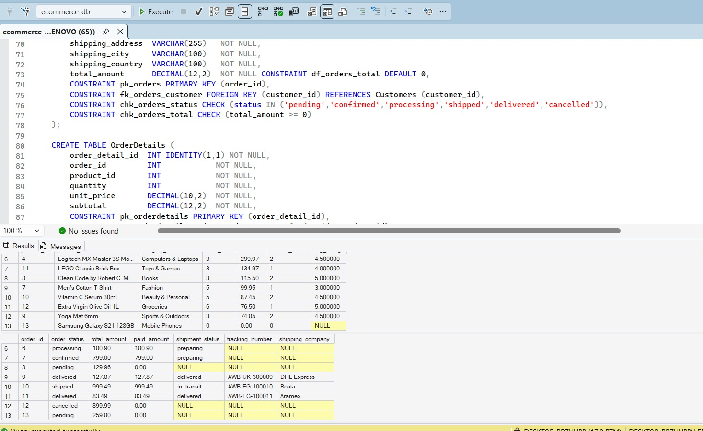
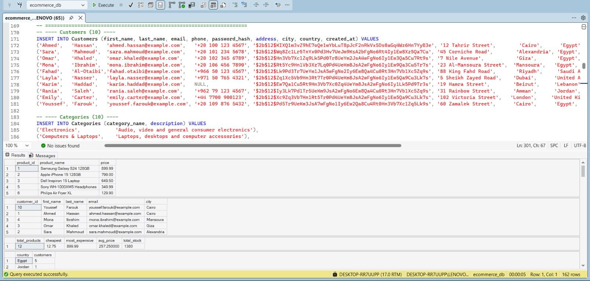
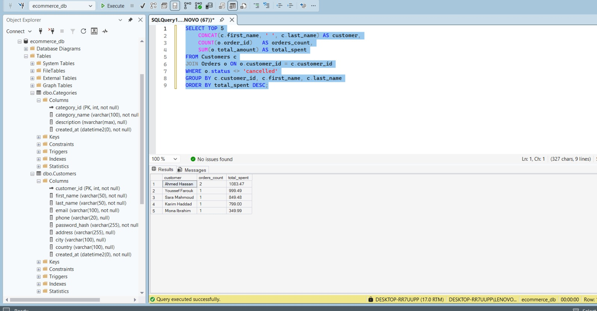

# E-Commerce Database System

A relational database design for an online shopping system with **exactly 8 tables**, built and tested in **Microsoft SQL Server (SSMS)**. A MySQL 8.0 version of the script is included too.

## ERD

## Tables
| Table | Purpose |
|---|---|
| Customers | Customer accounts and addresses |
| Categories | Product categories |
| Products | Products, prices and stock |
| Orders | Customer orders and status |
| OrderDetails | Items per order (resolves Orders ↔ Products many-to-many) |
| Payments | Payment attempts per order |
| Shipments | One shipment per order (at most) |
| Reviews | One review per customer per product |

## Relationships
- Customers 1 → N Orders, Customers 1 → N Reviews
- Categories 1 → N Products
- Orders 1 → N OrderDetails, Orders 1 → N Payments, Orders 1 → 0..1 Shipments
- Products 1 → N OrderDetails, Products 1 → N Reviews

## Design decisions
- `OrderDetails.unit_price` stores the price at order time, so later price changes don't affect old orders.
- `UNIQUE(order_id, product_id)` prevents duplicate products in one order; `UNIQUE(customer_id, product_id)` allows one review per product per customer.
- One order can have several payments (e.g. a failed attempt then a retry).
- No card numbers or other payment credentials are stored.
- SQL Server: `ENUM` columns are `VARCHAR` + `CHECK`; unique nullable columns (`transaction_reference`, `tracking_number`) use filtered unique indexes.

## What's inside the script
Tables, indexes, sample data (10+ rows per table), 4 views, 22 queries (JOIN, LEFT JOIN, GROUP BY, HAVING, subqueries) and INSERT / UPDATE / DELETE examples.

## How to run
1. Open `sql/ecommerce_database_sqlserver.sql` in SSMS.
2. Execute the whole script (F5). It drops and recreates the `ecommerce_db` database.

For MySQL 8.0 use `sql/ecommerce_database_mysql.sql`.

## Screenshots
| | |
|---|---|
|  |  |
|  | |
